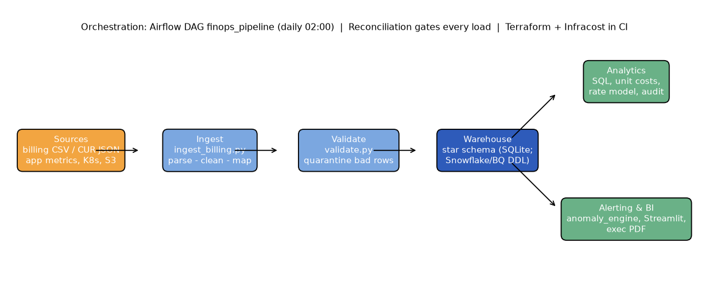

# Cloud Financial Intelligence Platform (Data Engineering & Cloud FinOps)

End-to-end pipeline: messy billing exports -> validated star-schema warehouse -> analytics, anomaly alerts, optimisation audit, dashboards.


> **Data note:** AWS billing exports were unavailable, so `src/generate_data.py` creates a synthetic CUR-style dataset (90 days, 300 resources, injected dirt and spikes).
> Swap in real CUR/Cost Management exports by pointing `ingest_billing.py` at them. Discount rates and unit prices in Days 11/13/19 are **illustrative assumptions**.
> Snowflake/BigQuery DDL (Day 10), Airflow DAG (Day 15), Terraform/Infracost (Day 17) and Streamlit (Day 18) were written but need those services to execute; local proxies are provided.

## Run
```bash
pip install -r requirements.txt
python src/generate_data.py && python src/run_pipeline.py      # ingest > validate > load > reconcile > anomalies > unit econ > audit
python src/run_sql.py sql/02_analytics.sql                      # Day 2 queries -> reports/query_output/*.csv
python tests/test_pipeline.py
streamlit run dashboard/app.py                                  # optional
```
## Layout
| Path | Contents |
|---|---|
| `sql/` | star schema DDL, 8 analytics queries, Postgres index script, BigQuery/Snowflake DDL, depreciation view |
| `src/` | ingestion, validation, load, reconcile, benchmarks, FinOps models, anomaly engine, runners |
| `dags/` | Airflow DAG `finops_pipeline_dag.py` |
| `terraform/`, `.github/workflows/` | sample IaC + Infracost CI |
| `policies/` | tagging policy, S3 lifecycle JSON |
| `reports/` | all generated outputs, reconciliation, data-quality report, `facts.json` |
| `outputs/` | Excel models, decks, executive dashboard PDF |
| `docs/` | ERD, architecture, charts |
